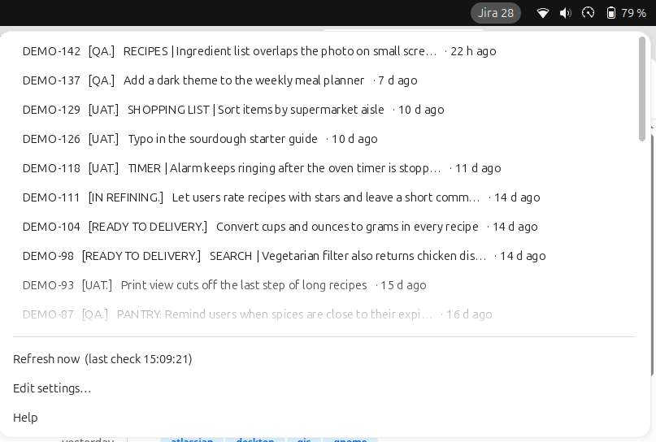

# Jira Indicator

[](https://github.com/your-github-user/jcm-gnome-jira-indicator/actions/workflows/ci.yml)

A GNOME Shell top-bar counter of the Jira issues that still need you. It refreshes on its own, marks what changed
since you last looked, and opens any issue in your browser with one click.



## Install

Nothing to install first. Paste one line in a terminal (`wget` is on every Ubuntu; `curl` works too):

```bash
wget -qO- https://raw.githubusercontent.com/your-github-user/jcm-gnome-jira-indicator/main/install.sh | bash
```

Then put your Jira site, email and [API token](https://id.atlassian.com/manage-profile/security/api-tokens) in
`~/.config/jcm-gnome-jira-indicator/config.ini`, and log out and back in.

Requires GNOME Shell 46 to 50 (Ubuntu 24.04 LTS or newer). Every setting and troubleshooting: [the user manual](MANUAL.md).

## When something goes wrong

The count gets a `⚠` and the menu shows why, using Jira's own reason when it gives one, for example
`Jira answered HTTP 400: Error in the JQL Query: Expecting ')' but got 'ORDER'.` The last good list stays visible.

Every error is also saved with the time, so you can see what happened while you were away:

```bash
tail ~/.local/state/jcm-gnome-jira-indicator/error.log
```

Only the last 200 lines are kept, and the token is never written to it. Fixes for each message:
[the user manual](MANUAL.md#when-something-goes-wrong).

## Uninstall

```bash
gnome-extensions uninstall jcm-gnome-jira-indicator@your-github-user.github.io                # removes the extension
rm -r ~/.config/jcm-gnome-jira-indicator ~/.local/state/jcm-gnome-jira-indicator  # removes your settings, token and error log
```

Then revoke the token at <https://id.atlassian.com/manage-profile/security/api-tokens>.

Developers who linked the folder with `make dev`: use `make uninstall` instead of `gnome-extensions uninstall`, which may
follow the link and delete files in your working copy.

### Uninstall by hand

The installer (`./install.sh`, `make install` or the one-line install) puts files in three places and turns the
extension on. To undo every part of it yourself:

```bash
UUID=jcm-gnome-jira-indicator@your-github-user.github.io

gnome-extensions disable "$UUID"                                   # turns it off and drops it from the enabled list
rm -rf ~/.local/share/gnome-shell/extensions/"$UUID"               # the extension files
rm -rf ~/.config/jcm-gnome-jira-indicator ~/.local/state/jcm-gnome-jira-indicator   # settings, token, seen state, error log
```

If `disable` says the extension does not exist (you have not logged out since installing), remove it from GNOME's
enabled list instead: run `gsettings get org.gnome.shell enabled-extensions`, then `gsettings set` the same list
without the `jcm-gnome-jira-indicator@…` entry, for example:

```bash
gsettings set org.gnome.shell enabled-extensions "['other@ext.org']"
```

`gnome-extensions list | grep jira` printing nothing confirms it is gone. Revoke the token as above.

## Development

`make help` lists the developer commands: `make test`, `make dev` (link this folder instead of copying), `make fetch`,
`make pack`.

## License

GPL-2.0-or-later. See [LICENSE](LICENSE).
